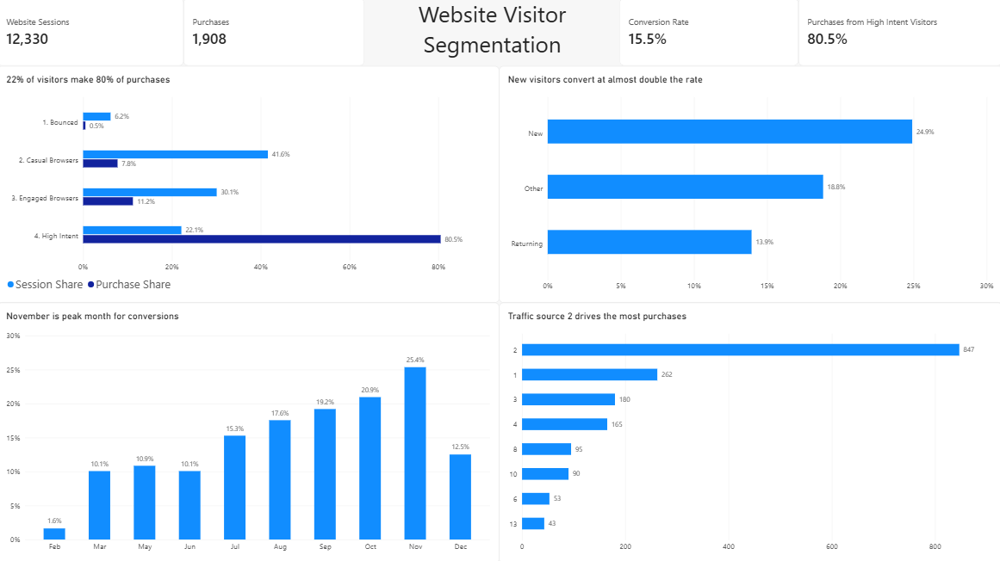

# E-commerce Website Visitor Segmentation & Conversion Analysis

**Tools:** SQL (SQLite), Power BI

**Author:** Merdi Mayindu

## Business problem

An online store gets thousands of website visits, but only about 1 in 7 ends in a purchase. This project uses Google Analytics-style session data to **segment website visitors by behaviour, find what separates buyers from browsers, and recommend where marketing and website improvements would lift conversions**.

## Dataset

[Online Shoppers Purchasing Intention](https://archive.ics.uci.edu/dataset/468/online+shoppers+purchasing+intention+dataset) (UCI Machine Learning Repository): 12,330 website sessions over one year, with pages viewed, time on site, bounce rate, exit rate, page value, traffic source, visitor type and whether the session ended in a purchase.

## Key metrics

| Metric | Meaning |
|---|---|
| Conversion rate | Sessions that ended in a purchase ÷ all sessions |
| Bounce rate | % of visitors who left after landing without doing anything else |
| Exit rate | % of page views where the page was the last in the session |
| Page value | Average value of a page seen before a purchase. Above 0 means the visitor reached pages that usually lead to sales |

## Data checks and cleaning

- **Revenue and Weekend stored as text** ("TRUE" / "FALSE") were converted to usable fields
- **Inconsistent month names:** "June" was changed to "Jun" to match the other months, and a month number was added for correct ordering. **January and April have no data.**
- **125 identical rows** were investigated. All were 1–2 page bounced sessions, most likely separate visitors who behaved the same way, so they were **kept** rather than wrongly removed as duplicates.
- Each session was placed in one of **4 behaviour segments**: Bounced, Casual Browsers, Engaged Browsers (20+ product pages) and High Intent (reached pages that usually lead to a sale).

## Key findings

| Area | Finding |
|---|---|
| Overall | 12,330 sessions, 1,908 purchases, **15.5%** conversion rate |
| High Intent | **22% of sessions make 80.5% of purchases**, converting at 56.3% |
| Browsing depth | Conversion rises from **4.3%** (≤5 product pages) to **25.3%** (51+) |
| Buyers vs browsers | Buyers view 48 product pages vs 29 and stay 34 minutes vs 20 |
| Visitor type | New visitors convert at **24.9%**, almost double returning visitors (13.9%) |
| Traffic sources | Source 2 brings 32% of traffic at 21.6%. Sources 1, 3 and 13 convert poorly |
| Seasonality | **November** delivers **40% of all purchases** at a 25.4% conversion rate |
| Special days | Visits near special days convert **worse** (6.2% vs 16.5%) |
| Opportunity | **3,351** returning visitors browsed heavily (53 pages) but converted at only 5.3% |

### Visitor segments

| Segment | % of sessions | % of purchases | Conversion rate |
|---|---|---|---|
| Bounced | 6.2% | 0.5% | 1.3% |
| Casual Browsers | 41.6% | 7.8% | 2.9% |
| Engaged Browsers | 30.1% | 11.2% | 5.8% |
| High Intent | 22.1% | 80.5% | 56.3% |

## Recommendations

1. **Guide more visitors to high-intent pages** through better product recommendations, navigation and calls to action.
2. **Retarget engaged returning browsers** with ads and abandoned-browse emails.
3. **Invest in new visitor acquisition,** since new visitors convert at almost double the rate.
4. **Rebalance traffic spend** towards source 2 and test scaling sources 8 and 5. Review sources 1, 3 and 13.
5. **Plan around November,** and start special-day promotions earlier with added urgency.

## Dashboard

## Files

| File | Description |
|---|---|
| `website_segmentation.sql` | All SQL queries, with the business question and finding for each |
| `website_dashboard.pbix` | Power BI dashboard |
| `dashboard.png` | Dashboard screenshot |
